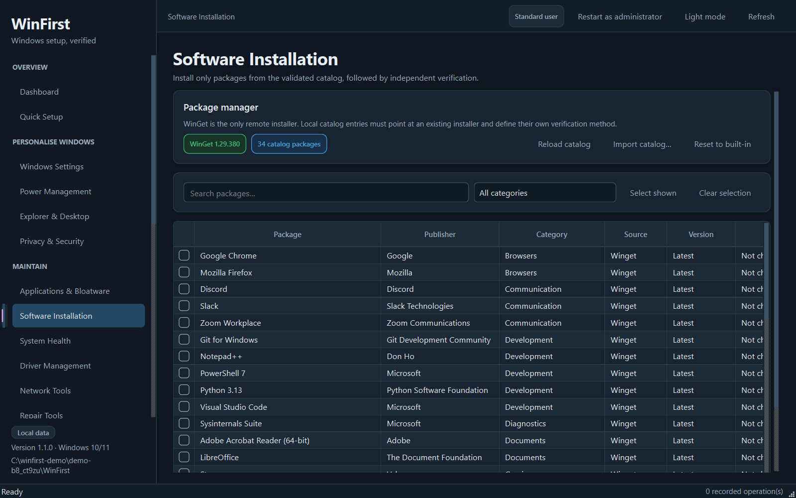
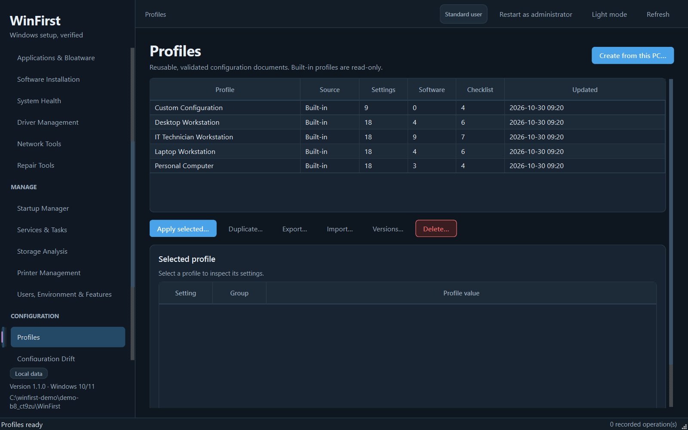

# WinFirst


WinFirst is a Windows 10/11 desktop toolkit for first-run setup, repeatable
configuration, cleanup, diagnostics and reporting. It is built with Python,
PySide6, SQLite and PowerShell, and is distributed as a portable executable or
an Inno Setup installer.

WinFirst is deliberately conservative: it previews every change, requires
explicit confirmation, verifies the result by reading the system back, records
the operation and offers rollback where the underlying change is reversible. It
does not "optimise" Windows by disabling security controls or by mass-disabling
services.





---

## What it does

| Area | Capabilities |
| --- | --- |
| **Dashboard** | Real hardware/OS summary, pending reboot, security posture, recent operations and quick links. |
| **Quick Setup** | Compare a built-in profile with the current computer, review every difference, apply only the approved changes, then re-detect. |
| **Windows Settings** | Explorer, desktop and privacy settings from a central registry, each with a read-back detector. |
| **Power Management** | Active plan, display/sleep timeouts on AC and battery, lid and power-button actions, hibernation and `powercfg` reports. |
| **Applications & Bloatware** | Installed-package inventory with protection classification, curated removal of optional/advanced items, and individual handling of unknown packages. |
| **Software Installation** | Install from a validated 34-package winget catalog; check presence, run the install, then verify independently. |
| **System Health** | CPU, memory, disks, SMART storage health, battery report, problem devices, Defender/firewall/UAC/Secure Boot/TPM/activation status. |
| **Driver Management** | Installed drivers, third-party driver packages, exportable packages and signed INF installation with verification. |
| **Network Tools** | Adapters, addresses, gateways, DNS, proxy state, DNS cache flush and explicit connectivity tests. |
| **Repair Tools** | Event-log review, application crashes, `sfc /scannow`, `DISM /RestoreHealth` and read-only `chkdsk`. |
| **Privacy & Security** | Privacy changes that are safe and reversible, plus read-only security posture checks. |
| **Explorer & Desktop** | File extensions, hidden files, Explorer start location, desktop icons and an optional God Mode folder. |
| **Startup Manager** | Sign-in startup entries with protected-entry detection, explicit enable/disable and verification. |
| **Services & Tasks** | Service inventory and startup modes, scheduled tasks, protected components excluded. Batch service disabling is refused. |
| **Storage Analysis** | Volumes, physical disks, approved cache cleanup, Recycle Bin and large-folder inspection. |
| **Printer Management** | Printers, queues, ports and narrowly scoped spooler repairs. |
| **Users, Environment & Features** | Local users/groups, environment variables and optional Windows features. |
| **Change Plans** | Every operation describes its exact steps and argument lists. Export a Markdown/JSON plan for review or approval, and run a dry run that records the plan without changing anything. |
| **System Restore** | Verified restore-point creation before a batch, reusing a recent checkpoint instead of fighting the Windows frequency limit, and refusing to continue when the checkpoint cannot be confirmed. |
| **Profiles** | Validated JSON profiles, version history and duplication of built-in profiles. |
| **Configuration Drift** | Compare the current machine against a profile and remediate only supported deviations. |
| **Deployment Checklist** | Three checklist templates, manual items and automatic checks (settings, admin rights, winget packages, safe PowerShell probes). |
| **Portable Toolkit** | Inventory a tools folder, hash files, inspect signatures/metadata and export the inventory. Files are never executed. |
| **History & Rollback** | Every recorded operation plus rollback for supported strategies. |
| **Reports** | Self-contained HTML and PDF reports, plus a redacted diagnostic ZIP with a manifest. |
| **Application Settings** | Theme, retention, report author, repository folder, database integrity check and data locations. |

Built-in data:

- 5 read-only profiles (personal, laptop, desktop, IT technician, custom starter)
- 26 independently detected/applied settings
- 34 validated winget packages
- 3 deployment checklist templates
- 13 SQLite tables for settings, profiles, versions, operations, rollback,
  catalog metadata, checklists, deployment sessions, reports, repository items
  and drift snapshots

---

## Safety model

Every state-changing flow follows the same lifecycle:

**Detect → Preview → Validate → Confirm → Apply → Verify → Log → Report**

Concretely:

- **Preview before apply.** A dialog lists each operation, its risk level,
  exact planned change, warnings and verification method. Nothing runs until
  the preview is accepted. High-risk batches require an explicit
  acknowledgment; critical operations require typing `CONFIRM`.
- **Plans are built from the action itself.** The operation specification used
  for execution is also used to render the plan, so the review cannot drift
  from what runs. Command steps are shown as argument lists, secrets are
  redacted, and the plan can be exported as Markdown or JSON for change
  approval. A dry run records the plan and applies nothing.
- **Optional restore point before a batch.** When System Protection is enabled
  and WinFirst is elevated, the preview offers to create a verified restore
  point first. A checkpoint newer than the Windows frequency window is reused
  rather than changing that setting. If the checkpoint cannot be confirmed, the
  requested changes are not applied.
- **Verification, not exit codes.** When a read-back exists, success requires it.
  Commands without an independent state API (for example SFC or a Winsock reset)
  are labelled as command-reported results, not presented as independently
  verified.
- **Protected components.** Security, update, networking, audio and core
  services are blocked from generic service changes. Microsoft scheduled tasks
  and framework/system/security applications are excluded from curated removal.
  The UI refuses to mass-disable services; the policy is enforced in the service
  layer and covered by tests.
- **No arbitrary code from profiles.** Profiles may only reference keys in the
  settings registry and never contain commands, scripts or installer URLs.
  Elevation requests are declarative JSON, expire, are re-validated by the
  elevated instance and are discarded after one use.
- **Catalogs are declarative, not scripts.** Winget entries cannot define silent
  arguments or local installers, and every entry needs an independent
  verification method. Importing a custom catalog is a trusted-operator action:
  local entries run an explicit, pre-existing `.exe`/`.msi` with declared
  arguments, so review an imported catalog before using it.
- **Security posture is read-only.** Defender, Firewall, UAC, Secure Boot, TPM
  and activation are inspected, never weakened. Default profiles cannot turn
  them off. Defender optional features cannot be disabled, and obsolete
  security engines (SMB 1.0, PowerShell 2.0) cannot be enabled.
- **Account safety.** Built-in and signed-in accounts are protected, and a
  batch enable/disable action is refused if it would leave no enabled
  administrator.
- **Never mass-remove.** App removal uses a curated classification; unknown
  packages are selectable individually with warnings.
- **No secrets in logs.** The central command runner redacts passwords, tokens,
  bearer headers, keys and connection strings before output is stored or shown.
- **Blocking work stays off the UI thread.** Commands run in workers with
  timeouts, cancellation and capped output. Cancellation does not leave an
  operation silently "in progress": the controller reads the state back where
  an independent check exists and labels operations that have none.
- **No silent downloads or script execution.** WinFirst never downloads and
  runs scripts. `sfc`, `DISM`, `chkdsk`, `sc`, `powercfg`, registry changes and
  winget are invoked as explicit, bounded commands. Local installers are only
  run when an operator explicitly imports a catalog that names an existing file.

Rollback is available for supported strategies: registry settings, power plans,
God Mode folder, startup entries, service startup/state, scheduled tasks,
environment variables and local user accounts. Rollback actions are themselves
recorded and verified.

---

## Requirements

- Windows 10 version 1809 or newer, or Windows 11 (x64)
- Python 3.11 or newer for running from source (tested with 3.13.15)
- Administrator rights for system-wide changes; read-only pages work as a
  standard user, though some inventories (optional features, some devices)
  return partial data
- `winget` (App Installer) only for the Software Installation page
- Inno Setup 6.3+ only for building the installer

---

## Run from source

```powershell
py -3.11 -m venv .venv
.\.venv\Scripts\Activate.ps1
python -m pip install --upgrade pip
pip install -r requirements.txt
python main.py
```

Alternatively:

```powershell
pip install -e .
python -m winfirst
```

Useful flags:

```text
--debug             verbose logging
--smoke-test        construct the application and all 24 pages, then exit
--elevated-request  internal: apply a validated post-elevation request
--version           print the version
```

---

## Testing

```powershell
$env:PYTHONPATH = "src"
python -m pytest -q

$env:QT_QPA_PLATFORM = "offscreen"
python scripts\ui_load_smoke.py

python main.py --smoke-test
```

- `pytest` covers the command runner and redaction, operation lifecycle and
  cancellation, change plans and dry runs, risk engine, schema validation,
  profiles and versions, settings registry, diff engine, cleanup safety,
  restore-point logic, audit/reporting, elevation requests, the software catalog
  and service-change policy.
- `ui_load_smoke.py` constructs the real `MainWindow` and **loads** all 24 pages
  against the current machine. It is read-only: no Apply button is clicked.
- The unit tests mock Windows commands. They are not a substitute for
  end-to-end integration testing on a disposable machine.

Live acceptance tests (disposable VM only, admin shell):

```powershell
powershell -ExecutionPolicy Bypass -File scripts\acceptance\run_acceptance.ps1 -ConfirmDisposableVM
```

Seven scenarios exercise the real apply/verify/restore path: a reversible
Explorer setting, plan-only read-back, power plan switch, a throw-away service,
a throw-away scheduled task, a sandbox folder cleanup, and an optional restore
point. They are skipped unless `WINFIRST_LIVE=1` is set by the runner, and the
runner writes JUnit results, evidence JSON and a summary per run. See
`scripts/acceptance/README.md`.

---

## Data locations

Default (per user):

```text
%LOCALAPPDATA%\WinFirst\
  winfirst.db       SQLite database
  logs\             winfirst.log
  reports\          HTML/PDF reports and diagnostic bundles
  bundles\          diagnostic ZIP staging
  exports\          exported inventories
  elevation\        one-use elevation request
```

Portable mode is enabled by either:

- setting `WINFIRST_PORTABLE_DATA=1`, or
- placing an empty `portable-data.txt` next to the executable.

In portable mode WinFirst uses `data\` next to the executable if that folder is
writable; otherwise it falls back to `%LOCALAPPDATA%`. `WINFIRST_DATA_DIR` can
point at an explicit writable folder.

WinFirst does not store passwords, tokens or product keys. Diagnostic bundles
redact sensitive values and include a manifest describing what was collected.
Reports do include machine-specific configuration, so review them before
sharing.

---

## Profiles

Profiles are JSON documents validated on import. A minimal example:

```json
{
  "schema_version": 1,
  "profile_name": "My standard desktop",
  "description": "Baseline for office workstations",
  "settings": {
    "show_file_extensions": true,
    "ac_display_timeout_minutes": 15,
    "disable_advertising_id": true
  },
  "software": [
    {"id": "7zip.7zip", "name": "7-Zip", "optional": true, "source": "winget"}
  ],
  "checklist": [
    {"key": "backup_confirmed", "title": "User data is backed up", "required": true}
  ]
}
```

- Unknown or unsupported setting keys are rejected rather than ignored.
- Built-in profiles are read-only; duplicate one in the Profiles page to edit it.
- Profile versions are stored in SQLite, so drift can be compared with the
  exact revision that was applied.
- Security controls are not profile settings. They are detected and reported,
  not applied.

---

## Build a portable executable

```powershell
python scripts\make_icon.py
powershell -ExecutionPolicy Bypass -File scripts\build_portable.ps1
```

Output: `dist\WinFirst.exe` (one-file). The script runs a clean PyInstaller
build and then executes `WinFirst.exe --smoke-test` to confirm that the packaged
application starts and constructs all pages.

For an onedir build (faster startup, easier code signing):

```powershell
powershell -ExecutionPolicy Bypass -File scripts\build_portable.ps1 -OneDir
```

Output: `dist\WinFirst\WinFirst.exe`.

The spec file is `WinFirst.spec`; PyInstaller is configured with the application
icon, Windows version resource and packaged resources. Set
`WINFIRST_ONEFILE=0` in the environment when invoking PyInstaller directly.

> An unsigned PyInstaller executable may trigger SmartScreen or an antivirus
> heuristic. Code-sign the executable for distribution. The one-file build also
> extracts to a temporary folder at startup; use the onedir build if that is not
> acceptable in your environment.

---

## Build the installer

```powershell
powershell -ExecutionPolicy Bypass -File scripts\build_installer.ps1
```

The script builds the portable executable, locates `ISCC.exe` (PATH, default
install locations, or `-Iscc <path>`), and compiles `installer\winfirst.iss`.

Output: `installer\Output\WinFirst-Setup-1.1.0.exe`.

Installer behavior:

- installs to `%ProgramFiles%\WinFirst` for all users
- Start Menu shortcut, optional desktop shortcut
- does **not** delete `%LOCALAPPDATA%\WinFirst` on uninstall
- requires Windows 10 1809+ x64
- the application itself requests elevation per action rather than forcing the
  whole UI to run elevated

If Inno Setup is missing, the script exits with code 2 and prints installation
instructions instead of claiming a build.

---

## Project layout

```text
src/winfirst/
  app.py                  startup, flags, exception hook, elevation request
  core/                   command runner, operations and change plans, database,
                          profiles, settings registry, diff/rollback, reports, paths
  models/                 profile and setting models
  services/               Windows integrations (apps, power, devices, cleanup,
                          drivers, network, repair, security, software, restore
                          points, ...)
  ui/                     main window, theme, shared widgets and dialogs,
                          workers, 24 pages
  resources/              QSS theme, profiles, catalog, checklists, icons
tests/                    156 unit tests plus 7 opt-in live acceptance tests
scripts/                  icon generation, UI smoke, build scripts,
                          acceptance runner and live scenarios
installer/                Inno Setup script and version resource
main.py                   development entry point
WinFirst.spec             PyInstaller definition
```

---

## Verification status

Be precise about what has and has not been exercised. This section reflects the
state of the repository at version 1.1.0.

Verified on the development machine:

- Source compiles with `python -m compileall -q src`.
- **156 unit tests pass** (`python -m pytest -q`); 7 live acceptance tests are
  collected and skipped unless the acceptance runner enables them.
- The headless UI load test loads all **24 pages** without an unhandled
  exception. Expected partial-data warnings appear for in-use temp folders and
  for optional-feature data that needs administrator rights.
- Read-only live inventory against the current Windows installation:
  settings, active power plan, hibernation status, installed applications,
  network adapters/gateway, devices with problems, startup entries, scheduled
  tasks, service inventory and winget version.
- Change plans were generated against the live machine for a real settings
  operation and the active power plan without changing state; the controller
  recorded no audit entry, and the plan showed the exact `powercfg` argument
  list and the current value.
- Three live acceptance scenarios were executed on the development machine and
  passed: a reversible Explorer setting (set to Enabled, confirmed by read-back,
  then restored to Disabled), a power-plan switch (Balanced, confirmed by GUID
  read-back, then the original Ultimate Performance plan restored), and a
  sandbox-folder cleanup (8,192 bytes deleted, verification confirmed that no
  matching files remained). The service, scheduled-task and restore-point
  scenarios were **not** executed.
- Restore-point **detection** was exercised live: System Protection is enabled,
  the frequency value is 1440 minutes, and the non-elevated UI correctly reports
  that administrator rights are required instead of offering a checkpoint that
  would fail.
- The packaged one-file executable was built with PyInstaller 6.22.3 and its
  `--smoke-test` passed, constructing all 24 pages from the frozen bundle. The
  Windows version resource and application icon are embedded.
- The installer was compiled with Inno Setup 6.7.3:
  `installer\Output\WinFirst-Setup-1.1.0.exe` (61.4 MiB).

**Not verified:**

- Service startup, scheduled-task toggle and restore-point creation scenarios,
  and the remaining apply paths (app removal, printers, network, users,
  features, driver/INF installation, rollback after a real change). The
  acceptance harness covers the first three but was not executed on this
  machine; treat those paths as unproven until it has.
- Restore-point read-back and creation (both require elevation; only detection
  was exercised).
- `sfc /scannow`, `DISM /RestoreHealth` and `chkdsk` completion on this machine.
  These operations can take a long time; their result reporting is based on
  command output and available read-back, not a separate verification API.
- winget package installation/removal (catalog IDs were validated, not all
  installs were executed).
- Windows 10, non-English Windows, ARM64, and multi-monitor/high-DPI layouts.
- Installer execution and uninstall (the installer compiled successfully but
  was not installed on this machine).
- Code signing and SmartScreen reputation.

The tests use mocked Windows commands; they prove the application's own logic,
not the behavior of every Windows build. Always test on a disposable VM or with
a backup before applying changes to a production computer.

---

## Known limitations

- **Localization:** some parsers expect English command output. Unsupported
  output is reported as unavailable rather than guessed.
- **ICMP:** connectivity tests can be blocked by firewall policy or the remote
  host even when the network is healthy.
- **SMART:** data depends on the storage driver and hardware; some USB/NVMe
  bridges do not expose it.
- **SFC/DISM:** there is no independent state API. WinFirst reports the command
  result and the repairable findings it can read; it does not claim a corruption
  fix that it cannot verify.
- **Defender tamper protection / policy:** some security reads may be
  unavailable or managed by organizational policy. WinFirst reports that state
  instead of overriding it.
- **winget:** requires App Installer, network access and package-source
  availability. Package IDs can be retired by publishers.
- **Optional features and some device details** require administrator rights;
  pages show partial-data warnings instead of failing.
- **Cleanup** only touches a fixed allowlist of caches. Files in use are skipped
  and the remaining size is measured again after deletion.
- **Reports** contain machine-specific information. Redaction reduces but does
  not eliminate the need to review a bundle before sharing it.

---

## Troubleshooting

- **Logs:** `%LOCALAPPDATA%\WinFirst\logs\winfirst.log`, or `data\logs` in
  portable mode. Start with `python main.py --debug` for verbose output.
- **"Administrator required":** use the top-bar button to relaunch elevated.
  The elevated instance re-validates the request and asks for confirmation
  again.
- **No winget:** install App Installer from the Microsoft Store, then reopen
  the page.
- **Antivirus/SmartScreen warning:** the executable is unsigned. Verify the
  source and sign your distribution build.
- **Database:** Application Settings has an integrity check, retention action
  and a guarded history clear. Back up `winfirst.db` before manual changes.

WinFirst has no telemetry. Network access only occurs for actions that need it,
such as winget operations and explicit connectivity tests.

---

## License

MIT. See [LICENSE](LICENSE).

PySide6/Qt, psutil, reportlab, PyInstaller and Inno Setup retain their own
licenses; review them before redistributing binaries.
